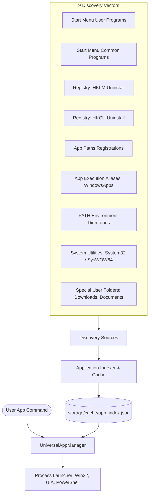

# JARVIS-10: Universal Application Discovery & Interaction

## 1. Overview

JARVIS-10 interacts with any discoverable Windows application across the operating system without relying on hardcoded lists or fixed paths. The `UniversalAppManager` (`modules/computer_use/app_manager.py`) and `AppDiscoveryEngine` (`modules/computer_use/app_discovery.py`) continuously maintain an index of installed applications across all Windows launch vectors.

---

## 2. Multi-Vector Discovery Engine

The application index maintains 340+ indexed applications, recording:
- `name`: Display name of the application.
- `executable_path`: Full binary path, protocol URI, or execution alias.
- `app_type`: `win32`, `uwp`, `system_utility`, `alias`, or `folder`.
- `launch_method`: Direct execution, `os.startfile`, or PowerShell execution.

### 2.1 Fuzzy Name Resolution & Natural Descriptions
Users can refer to applications in diverse ways:
- **Direct Names**: *"Open Chrome"*, *"Launch Visual Studio Code"*, *"Start Calculator"*.
- **Functional Descriptions**: *"Open the application I use for Python"* $\to$ resolves to VS Code.
- **Category Queries**: *"Open my music player"* $\to$ resolves to Spotify.
- **Special Folders**: *"Open my downloads folder"* $\to$ opens Windows Explorer at `$HOME/Downloads`.

---

## 3. Universal Application Navigation & Control

Once an application is open:
1. **Window Identification**: `computer.inspect_active_window` identifies the HWND handle, window title, and process.
2. **Accessibility Inspection**: `computer.inspect_ui` traverses the UI Automation tree to locate buttons, edit fields, and tabs.
3. **Control Invocation**: `computer.click` clicks on buttons by accessible name (e.g. *"Click Save"*).
4. **Typing & Shortcuts**: `computer.type` simulates natural typing, while `computer.press_key` handles `Enter`, `Tab`, and hotkeys (`Ctrl+S`, `Alt+Tab`).
5. **Window Switching**: `computer.switch_window` brings background applications directly into focus.
