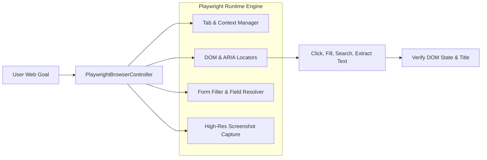

# JARVIS-10: Universal Browser Automation Specification

## 1. Overview

The JARVIS-10 Universal Browser Automation Engine (`modules/computer_use/browser_playwright.py`) coordinates Chromium, Google Chrome, and Microsoft Edge browser instances. It handles multi-tab navigation, complex form completion, DOM and visual locator mapping, file downloads, and high-fidelity page captures.

---

## 2. Core Operational Capabilities

### 2.1 Multi-Tab & Session Management
- **Concurrent Tabs**: Supports multiple active tabs within a shared or isolated browser context.
- **Tab Inspection**: `browser.get_tabs` lists all open pages with titles, active indices, and current URLs.
- **Tab Switching**: `browser.switch_tab(index)` brings the target tab to the foreground without losing session state.

### 2.2 Robust Multi-Strategy Locators
When interacting with web elements (`browser.click`, `browser.fill`), the engine uses a 4-tier fallback:
1. **Direct CSS / ID Locators**: `input#search`, `button[type="submit"]`.
2. **Accessible Text Locators**: `get_by_text("Sign In", exact=False)`.
3. **Role & ARIA Locators**: `get_by_role("button", name="Submit")`.
4. **Evaluated DOM Traversal**: In-browser JavaScript traversal to locate elements by partial inner text or computed label.

### 2.3 YouTube Automation Workflow
- **Search & Synthesis**: `youtube.search(query)` navigates to YouTube, waits for `ytd-video-renderer`, extracts top video cards (title, creator, views, URL), and formats a concise audio summary.
- **Video Selection**: `youtube.play_video(result_index=1)` navigates to the first video, or opens the 3rd result (`result_index=3`).
- **Keyboard Shortcuts**: `youtube.control_playback` maps actions directly to native YouTube player shortcuts:
  - `play` / `pause`: `k` or `Space`
  - `mute` / `unmute`: `m`
  - `volume_up`: `ArrowUp`
  - `volume_down`: `ArrowDown`
  - `fullscreen`: `f`

### 2.4 Arbitrary Webpage Exploration
- `browser.open(url)`: Navigates to any standard HTTP/HTTPS webpage.
- `browser.extract_text()`: Strips scripts and navigation chrome, returning the core readable article or content.
- `browser.screenshot()`: Saves timestamped PNG captures to `storage/media/browser_captures/`.
