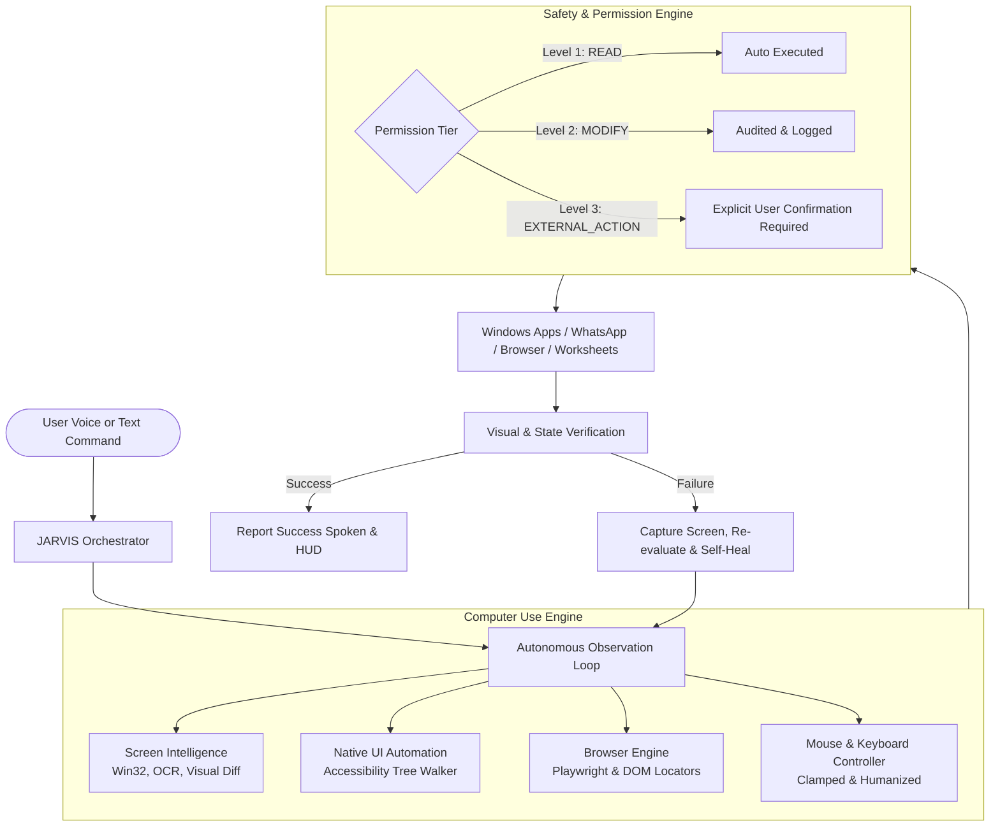
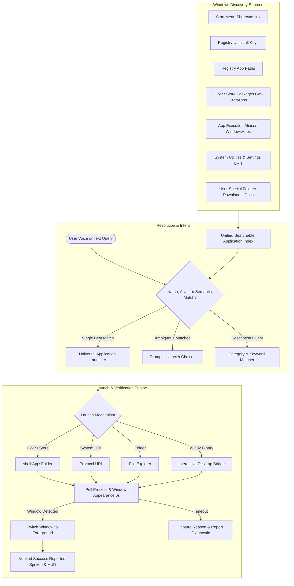

# JARVIS-7: Autonomous Computer Use & Visual Intelligence Architecture

## 1. System Overview & Objective

JARVIS Mark VII transforms the assistant from a voice interface into an autonomous, verified computer-use agent. The system observes the desktop environment, extracts structural and visual context, reasons over intended goals, executes actions through native Windows APIs and browser primitives, verifies every action outcome, and self-heals when unexpected conditions occur.



---

## 2. Four-Tier Reliable Interaction Hierarchy

To guarantee reliability without blindly relying on fragile mouse coordinates, JARVIS prioritizes interaction methods according to four tiers:

| Tier | Engine | Implementation | When Used |
| :--- | :--- | :--- | :--- |
| **Tier 1** | **Accessibility Tree / UI Automation (UIA)** | `uiautomation`, `pywinauto` | Native Windows controls, buttons, text fields, tabs, menus, dialogue boxes. Extracts exact bounding boxes and supports direct `Invoke()` or `SetValue()`. |
| **Tier 2** | **Browser DOM & Locators** | Playwright, BeautifulSoup, XPath | Online web forms, worksheets, web applications. Inspects tags, IDs, labels, input fields, and radio/checkbox groups directly. |
| **Tier 3** | **OCR & Visual Detection** | OpenCV, Tesseract OCR, Gemini Vision | Canvas elements, custom non-standard UI controls, terminal outputs, error dialogs, image buttons. |
| **Tier 4** | **Clamped Mouse & Keyboard Coordinates** | PyAutoGUI | Fallback when element trees or DOM nodes are unavailable. Bounds-checked, smoothed, and emergency-stop guarded. |

---

## 3. Autonomous Observation Loop (`OBSERVE` → `UNDERSTAND` → `PLAN` → `ACT` → `VERIFY` → `REPEAT`)

Every computer-use task runs inside the `AutonomousObservationLoop` ([modules/computer_use/loop.py](file:///c:/Users/karth/OneDrive/Desktop/sanju/modules/computer_use/loop.py)):

```mermaid
sequenceDiagram
    participant Loop as Observation Loop
    participant Screen as Screen Intelligence
    participant Action as Target Action
    participant Perm as Permission Engine
    participant Verifier as State Verifier

    Loop->>Screen: Capture Before-State (Window, Hash, Screenshot)
    Loop->>Perm: Check Action Level & Verify Emergency Stop
    alt Emergency Stop Triggered
        Perm-->>Loop: Block Execution Immediately
    else Permission Approved
        Loop->>Action: Execute Action (Click, Type, Launch)
        Loop->>Screen: Capture After-State (Window, Pixels)
        Loop->>Verifier: Compare Visual Diff & Window State
        alt Verification Passed (Change Detected or Title Matches)
            Verifier-->>Loop: Success (Outcome Confirmed)
        else Verification Failed
            Verifier-->>Loop: Discrepancy Detected
            Loop->>Screen: Capture Error Screenshot & Extract OCR
            Loop->>Loop: Re-evaluate Context & Retry (Up to Max Attempts)
        end
    end
```

### Self-Healing & Recovery
1. **State Discrepancy:** If after clicking a button no visual change occurs ($\text{pixel change ratio} < 0.001$) and the active window does not change, JARVIS captures the current screen, analyzes error text via OCR, moves the cursor, re-locates the element via accessibility tree, and retries.
2. **Window Loss:** If a dialog unexpectedly closes or changes focus, JARVIS re-enumerates top-level HWNDs and restores focus before retrying.
3. **Execution Cap:** Retries are strictly bounded (default: 3 attempts) to prevent infinite loops.

---

## 4. WhatsApp Automation Subsystem

The WhatsApp module ([modules/computer_use/whatsapp.py](file:///c:/Users/karth/OneDrive/Desktop/sanju/modules/computer_use/whatsapp.py)) handles end-to-end messaging workflows without user manual intervention while strictly enforcing safety:

### Workflow:
1. **Contact Resolution:**
   - Normalizes spoken terms (e.g. *"send Hi to my father"*, *"en father ku message anupu"*, *"Papa ko text karo"*).
   - Resolves relation aliases (`father` $\rightarrow$ `Dad`, `Appa`, `Papa`, `Father`) against `ProfileMemory`.
   - Never sends to ambiguous or unconfirmed contacts.
2. **App / Web Launch:**
   - Detects running WhatsApp Desktop instance or launches WhatsApp via URI `whatsapp://` or Chrome WhatsApp Web.
3. **Message Preparation & Challenge:**
   - Formulates draft message: `recipient: "Father"`, `message: "Hi"`.
   - Raises a **Level 3 External Action Permission Challenge**:
     `"Prepared WhatsApp message to Father: 'Hi'. Say 'Yes' or confirm on HUD to send."`
4. **Execution & Delivery Verification:**
   - Upon confirmation (via voice `"Yes"` / `"Aama"` / `"Haan"` or HUD approval), sends message.
   - Verifies the message bubble appears in the active conversation transcript using UIA/OCR.

---

## 5. Online Worksheet & Form Automation Subsystem

The Worksheet module ([modules/computer_use/worksheet.py](file:///c:/Users/karth/OneDrive/Desktop/sanju/modules/computer_use/worksheet.py)) enables autonomous completion of online assignments, surveys, and forms:

### Workflow:
1. **DOM Inspection & Question Extraction:**
   - Locates form fields, questions, labels, options (text, radio, checkbox, textarea).
   - Extracts exact question texts and input types.
2. **Classification & Research:**
   - Classifies question type (multiple choice, open text, numeric).
   - Searches local knowledge base and web search client (`WebSearchClient`) for factual answers.
   - Never hallucinates answers when evidence is insufficient; flags low-confidence questions for user guidance.
3. **Field Population:**
   - Matches researched answers to the respective DOM inputs or screen coordinates.
   - Types values or selects appropriate radio/checkbox options with human-like delays.
4. **Answer Review & Authorization Guard:**
   - Summarizes all extracted questions and completed answers.
   - **Level 3 Security Challenge**: Form submission (`submit_worksheet`) is permanently gated until the user explicitly authorizes final submission.

---

## 6. Screen Intelligence & Multi-Window Understanding

The Screen Intelligence engine ([modules/computer_use/screen.py](file:///c:/Users/karth/OneDrive/Desktop/sanju/modules/computer_use/screen.py)) provides situational awareness:
- **Active Window Detection:** Extracts window HWND, title, process name (`chrome.exe`, `Code.exe`, `WhatsApp.exe`), and bounding geometry.
- **Visual State Comparison:** Computes pixel-wise absolute difference ratios between consecutive screenshots to verify whether UI state changes occurred.
- **OCR Extraction:** Runs local Tesseract OCR on region or full screen to parse text, buttons, and error messages.
- **Multi-Window Context:** Enumerates open desktop windows so JARVIS knows what application the user is currently working on.

---

## 7. Universal Windows Application Discovery & Control Engine

The Universal Application Management system ([modules/computer_use/app_discovery.py](file:///c:/Users/karth/OneDrive/Desktop/sanju/modules/computer_use/app_discovery.py) and [modules/computer_use/app_manager.py](file:///c:/Users/karth/OneDrive/Desktop/sanju/modules/computer_use/app_manager.py)) completely eliminates hardcoded application lists by dynamically discovering and controlling all Windows 11 software:



### Discovery Coverage:
1. **Windows Start Menu:** Scans `%ProgramData%` and `%AppData%` for all `.lnk` shortcuts.
2. **Windows Registry:** Scans `HKLM`, `WOW6432Node`, and `HKCU` `Uninstall` keys.
3. **App Paths:** Queries registered executables in `SOFTWARE\Microsoft\Windows\CurrentVersion\App Paths`.
4. **Microsoft Store & UWP:** Queries `Get-StartApps` for package IDs and `shell:AppsFolder` targets.
5. **App Execution Aliases:** Scans `%LOCALAPPDATA%\Microsoft\WindowsApps`.
6. **System Utilities & Settings:** Pre-maps canonical system utilities (Task Manager, Calculator, Settings `ms-settings:`, Control Panel, Paint, Terminal).
7. **Special Folders:** Indexes Downloads, Documents, Desktop, Pictures, Videos, and Music.

### Window Switching & Graceful Control:
- **Thread Input Attachment:** Uses `win32process.AttachThreadInput` to overcome Windows 11 foreground locking when switching windows.
- **Graceful Window Close:** Sends `WM_CLOSE` to allow apps to prompt for unsaved changes before resorting to process termination.
- **Unsaved Work Guard:** Detects open dirty state indicators (`*` or `unsaved` in title) on productivity apps (VS Code, Word, Excel, Notepad) and requires confirmation before closing.
