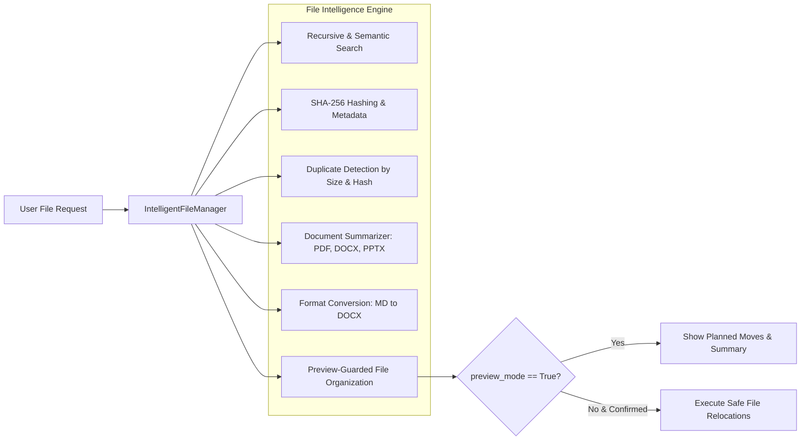

# JARVIS-8: Intelligent File Management & Analysis

## 1. Overview

The JARVIS-8 File Intelligence module (`modules/files/manager.py` and `modules/files/office_generator.py`) provides deep inspection, semantic discovery, binary verification, format conversion, and preview-guarded file organization across Windows filesystems.

---

## 2. Core Capabilities

### 2.1 Recursive & Semantic File Search
- **Recursive Search (`recursive_search`)**: Walks directory trees with regex pattern matching, file extension filtering, and maximum depth constraints. Excludes hidden directories and `.git` by default for high performance.
- **Semantic Vector Search**: Integrates with `SemanticMemory` to locate documents based on natural language queries (e.g. *"find the paper about drone delivery models"*), even when the filename does not contain the keywords.

### 2.2 Metadata Extraction & Binary Integrity
- Extracts file sizes, creation timestamps, last modified timestamps, and MIME types.
- Computes **SHA-256 cryptographic hashes** for exact verification and tamper detection.
- **Magic-Byte Integrity Check**: Inspects raw binary header bytes:
  - Office Open XML (`.docx`, `.pptx`, `.xlsx`): Validated against `PK\x03\x04` zip headers.
  - PDF documents: Validated against `%PDF-`.
  - PNG/JPEG images: Validated against `\x89PNG` and `\xFF\xD8\xFF`.

### 2.3 Duplicate Detection Engine
- Implements two-stage duplicate detection for maximum disk I/O efficiency:
  1. **Stage 1 (Size Grouping)**: Scans files and groups them by exact byte size. Files with unique sizes are immediately discarded without hashing.
  2. **Stage 2 (SHA-256 Comparison)**: Computes hashes only for files that share identical byte sizes, identifying exact byte-for-byte duplicates.

### 2.4 Preview-Guarded File Organization
- **Never deletes or moves files without preview**:
  - Calling `organize_directory(directory, preview_mode=True)` analyzes files, categories (Documents, Code, Media, Archives), and returns a plan detailing:
    - `total_files_analyzed`
    - `total_files_to_move`
    - `planned_moves: [{"source": ..., "destination": ..., "category": ...}]`
  - Moves are executed only when explicitly invoked with `preview_mode=False` after user review.

### 2.5 Document Summarization & Format Conversion
- Summarizes multi-page `.pdf`, `.docx`, `.pptx`, and `.txt` documents using structured extractive algorithms.
- Converts Markdown files (`.md`) directly into formatted Word documents (`.docx`) with preserved headers, bullet lists, and code blocks.
