# JARVIS AI — COMPLETE SYSTEM ARCHITECTURE & TECHNICAL BLUEPRINT

## 1. Executive Summary

JARVIS (Just A Rather Very Intelligent System) is a production-grade personal artificial intelligence operating system engineered specifically for Windows desktop environments. JARVIS merges multi-modal conversational reasoning, always-on duplex voice interaction with instant acoustic barge-in, universal Windows computer automation, authentic Spotify desktop control, sandboxed browser interaction, and a cybernetic holographic HUD with an animated SVG robot face.

---

## 2. High-Level Architectural Diagram

```mermaid
flowchart TD
    subgraph UI_Layer ["Holographic Presentation & Avatar Layer"]
        REACT_HUD["React 18 + Vite HUD (Port 5173)"]
        AVATAR_WIDGET["Floating Desktop AI Face Widget"]
        WS_CLIENT["Bidirectional WebSocket Client (/ws/hud)"]
    end

    subgraph API_Layer ["API Gateway & Communication Core (Port 8000)"]
        FASTAPI["FastAPI Application"]
        WS_STREAM["HUD Streaming WebSocket Manager"]
        REST_ROUTERS["Modular REST Routers (/api/voice, /api/tasks, /api/spotify, /api/automation, /api/sessions)"]
        AUTH_GUARD["Security & 3-Tier Permission Guard"]
    end

    subgraph Intelligence_Core ["AI Brain & Reasoning Subsystem"]
        ORCHESTRATOR["Brain Orchestrator & Multi-Turn Router"]
        TOOL_REGISTRY["Central Tool Registry (11 Subsystems)"]
        PROVIDER_FALLBACK["Resilient Multi-Provider Fallback"]
        GEMINI["Google Gemini API (Primary Cloud)"]
        CLAUDE["Anthropic Claude (Secondary Cloud)"]
        OLLAMA["Local Ollama LLM (Offline Neural Core)"]
        MOCK_BRAIN["Deterministic Safe Fallback"]
    end

    subgraph Voice_Subsystem ["Duplex Voice & Audio Pipeline"]
        STATE_MACHINE["VoiceStateMachine (7 Lifecycle States)"]
        WAKE_DETECTOR["Wake-Word Detector ('Hey Jarvis')"]
        VAD["Voice Activity Detector (RMS Energy Frame Slicing)"]
        STT["Dual-Tier STT (Local Whisper + Google STT)"]
        TTS["Edge-TTS Neural Voice + SAPI5 pyttsx3 Fallback"]
        DUPLEX["Duplex Barge-In Interruption Controller"]
    end

    subgraph OS_Automation ["Universal Computer Use & Integrations"]
        APP_MGR["Universal Application Manager (Win32 + UWP)"]
        UIA["Native UIAutomation & Window Tree Inspector"]
        PLAYWRIGHT["Playwright Chromium Browser Engine"]
        BOT_DETECTOR["Bot Verification & CAPTCHA Sentinel"]
        SPOTIFY_CORE["Authentic Spotify Controller (GSMTC + Web API)"]
        SHELL["Sandboxed PowerShell Execution Guard"]
        LEETCODE["LeetCode & Algorithmic Practice Workflows"]
    end

    subgraph Persistence ["Storage & Memory Subsystem"]
        SQLITE["SQLite Relational DB (jarvis.db)"]
        DAG_STORE["DAG Task & Execution Progress Persistence"]
        SESSION_STORE["Multi-Turn Conversation & Message Store"]
        SEMANTIC_STORE["Local Vector & Semantic Memory Store"]
    end

    REACT_HUD <--> WS_CLIENT
    WS_CLIENT <--> WS_STREAM
    WS_STREAM <--> ORCHESTRATOR
    WS_STREAM <--> STATE_MACHINE

    FASTAPI --> REST_ROUTERS
    REST_ROUTERS --> AUTH_GUARD
    AUTH_GUARD --> TOOL_REGISTRY

    ORCHESTRATOR --> PROVIDER_FALLBACK
    PROVIDER_FALLBACK --> GEMINI
    PROVIDER_FALLBACK --> CLAUDE
    PROVIDER_FALLBACK --> OLLAMA
    PROVIDER_FALLBACK --> MOCK_BRAIN

    ORCHESTRATOR --> TOOL_REGISTRY
    TOOL_REGISTRY --> APP_MGR
    TOOL_REGISTRY --> UIA
    TOOL_REGISTRY --> PLAYWRIGHT
    TOOL_REGISTRY --> SPOTIFY_CORE
    TOOL_REGISTRY --> SHELL
    TOOL_REGISTRY --> LEETCODE

    PLAYWRIGHT --> BOT_DETECTOR

    STATE_MACHINE <--> DUPLEX
    DUPLEX --> TTS
    WAKE_DETECTOR --> STATE_MACHINE
    STT --> ORCHESTRATOR

    ORCHESTRATOR <--> PERSISTENCE
    DAG_STORE <--> SQLITE
    SESSION_STORE <--> SQLITE
```



---

## 3. Subsystem Breakdown

### 3.1. AI Brain & Reasoning Engine (`core/brain/`)
- **Brain Orchestrator (`core/brain/orchestrator.py`)**: Intercepts natural speech and chat inputs, retrieves SQLite conversational context, executes intent analysis, and dispatches structured function calls.
- **Provider Fallback Matrix (`core/providers/`)**:
  1. *Tier 1: Google Gemini API* (`gemini_provider.py`) — Fast, deep multi-turn context with function schema calling.
  2. *Tier 2: Anthropic Claude* (`anthropic_provider.py`) — Production reasoning backup with tool declarations.
  3. *Tier 3: Local Ollama* (`ollama_provider.py`) — Zero-latency offline neural operation (`llama3.2:3b`).
  4. *Tier 4: Deterministic Fallback* (`mock_provider.py`) — Guarantees continuous OS operation even if internet and GPU are offline.
- **Central Tool Registry (`core/brain/tools.py`)**: Unified decorator `@jarvis_tool` with permission enforcement (Levels 1 to 3).

### 3.2. Advanced Voice Subsystem (`modules/voice/`)
- **Central Voice State Machine (`modules/voice/state_machine.py`)**:
  - Implements 7 strict states: `IDLE`, `LISTENING`, `PROCESSING`, `THINKING`, `SPEAKING`, `INTERRUPTED`, `ERROR`.
  - Automatically synchronizes holographic avatar face expressions and streams telemetry over `/ws/hud`.
- **Acoustic Duplex Barge-In (`modules/voice/duplex.py`)**:
  - Continuously processes microphone PCM chunks with RMS energy calculations.
  - When user speaks while JARVIS is vocalizing, instantly terminates TTS speech output within <50ms.
- **Dual-Tier STT (`modules/voice/stt.py`)**: Local Whisper neural recognition with online Google Speech fallback.
- **Dual-Tier TTS (`modules/voice/tts.py`)**: High-fidelity Microsoft Edge-TTS neural streaming voices in English and Tamil with zero-latency Windows SAPI5 pyttsx3 fallback.

### 3.3. Authentic Spotify Integration (`modules/media/spotify_controller.py`, `spotify_controller.py`)
- **Zero Simulation Architecture**: Never fabricates or fakes song playback.
- **Layer 1: Windows Global System Media Transport Controls (GSMTC)**: Uses asynchronous WinRT APIs to inspect actual Windows playback state, active track title, artist, and send hardware media keys (Play/Pause, Next, Previous, Volume).
- **Layer 2: Spotify Web API**: OAuth authorization for deep catalog search, album artwork, track uri resolution, and remote device transfer when available.
- **Layer 3: Windows Process & Desktop Lifecycle**: Auto-detects desktop application, expands portable system paths (`%APPDATA%\Spotify\Spotify.exe`), launches minimized or focused, and verifies process execution.

### 3.4. Desktop & Browser Automation (`modules/automation/`, `modules/computer_use/`)
- **Universal Application Manager (`modules/computer_use/app_manager.py`)**:
  - Eliminates hardcoded absolute user paths in favor of Windows environment variables (`%APPDATA%`, `%LOCALAPPDATA%`).
  - Indexes 140+ applications across Start Menu, UWP AppX packages, App Execution Aliases, and System PATH.
- **UI Automation (UIA) & Screen Understanding (`modules/computer_use/native_uia.py`, `screen.py`)**: Inspects accessible Windows elements, focuses windows, clicks buttons, and reads labels.
- **Playwright Universal Browser Engine (`modules/computer_use/browser_playwright.py`)**: Controls Chromium/Edge sessions with DOM selector strategy, form auto-filling, multi-tab switching, and cookie persistence.
- **Bot Verification & CAPTCHA Sentinel**: Detects Cloudflare Turnstile, reCAPTCHA, and hCaptcha bot gates. Strictly obeys safety guardrails by informing the user to solve challenges in the visible browser rather than attempting illegal bypasses.
- **LeetCode & Coding Practice Workflows (`modules/computer_use/leetcode.py`)**: Curated coding problem catalog, problem description parsing, and automated test case extraction for technical preparation.

### 3.5. Security, Guardrails & Sandboxing (`core/security/permissions.py`, `modules/automation/shell.py`)
- **3-Tier Permission Hierarchy**:
  - *Level 1 (Read-Safe)*: Telemetry, search, song status, window listing (Auto-approved).
  - *Level 2 (Standard Action)*: Launching applications, browser navigation, volume adjustments, creating tasks (Authenticated).
  - *Level 3 (Sensitive / Destructive)*: Sending communications (WhatsApp), submitting forms, system power actions (shutdown/restart), destructive shell execution (Requires explicit biometric/voice/HUD user confirmation challenge).
- **PowerShell Sandboxing**: Regex AST inspection blocks destructive commands (`Format-Volume`, `Remove-Item -Recurse C:`, `del /f /s /q`).

### 3.6. Persistent Storage & DAG Planning (`storage/db/`, `core/planning/`)
- **SQLite Database (`storage/db/models.py`)**: Persistent storage for conversations, user entities, hardware logs, and multi-step tasks.
- **DAG Task Executor (`core/planning/executor.py`)**:
  - Decomposes high-level user goals into Directed Acyclic Graphs of subtasks.
  - Persists task DAG progress to SQLite at start, after each execution wave, and on completion.
  - Recovers plan status across server restarts.

---

## 4. Telemetry and Communication Protocols

### 4.1. WebSocket `/ws/hud` Packet Structure
```json
// Agent Status Broadcast
{
  "type": "agent_state",
  "state": "idle" | "listening" | "thinking" | "speaking" | "executing" | "error",
  "message": "Standing by."
}

// Voice State Broadcast
{
  "type": "voice_state",
  "state": "idle" | "listening" | "processing" | "thinking" | "speaking" | "interrupted" | "error",
  "reason": "User interrupted speech"
}

// Hardware Telemetry (Every 1.0s)
{
  "type": "telemetry",
  "data": {
    "cpu": { "percent": 18.5, "cores": 16 },
    "ram": { "used_gb": 10.5, "total_gb": 15.8, "percent": 66.5 },
    "disk": { "percent": 85.0 },
    "battery": { "percent": 80, "power_plugged": true }
  }
}
```
