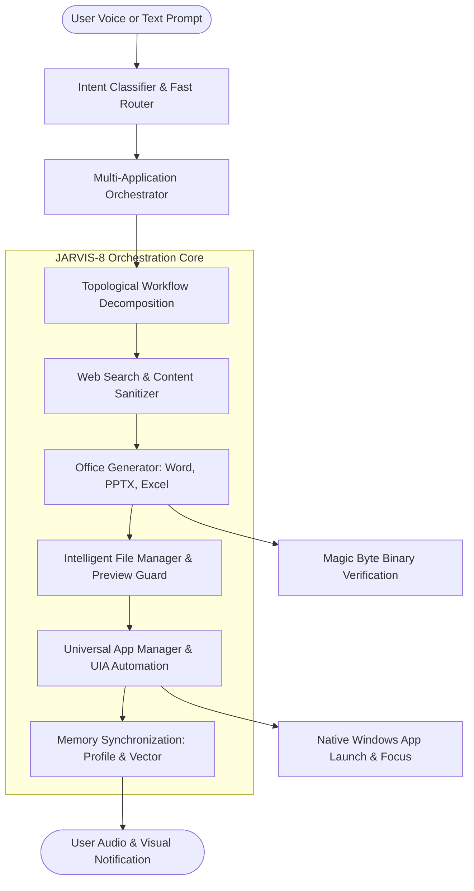

# JARVIS-8: Multi-Application Architecture & Coordination Specification

## 1. Executive Summary & Objective

JARVIS-8 expands the capabilities of the JARVIS AI Operating System from an interactive voice and single-application controller into an **Autonomous Multi-Application Intelligence Engine**. 

Modern workflows rarely exist inside a single sandbox or application window. A single objective—such as *"Research autonomous warehouse robots, prepare a report, and create a presentation"*—requires seamless, synchronized orchestration across:
- **Web Browsers / Search Engines**: Searching DuckDuckGo/Google, scraping web pages, defanging untrusted content.
- **Document Generators**: Generating standardized Microsoft Word (`.docx`), Microsoft PowerPoint (`.pptx`), and Excel (`.xlsx`) files.
- **Local File System**: Searching recursively, indexing metadata, hashing SHA-256 signatures, organizing directories.
- **Development & System Tools**: Visual Studio Code, Windows Terminal, and PowerShell.
- **Desktop Viewers & OS**: Windows 11 Shell, Task Manager, Default Handlers, and UI Automation.
- **Memory Systems**: Working memory, Long-term Profile Memory, and Vector Semantic Store.

---

## 2. Core Architecture Components

### 2.1 The Multi-Application Orchestrator (`modules/orchestration/multi_app.py`)
The `MultiAppOrchestrator` is the central coordination node. It executes 10-step autonomous workflows:
1. **Goal Decomposition**: Parses high-level objectives into concrete tool operations.
2. **Autonomous Research**: Executes web queries using `WebSearchClient` and `WebScraper`.
3. **Safety Sanitization**: Passes all scraped HTML/text through `ContentSanitizer` to prevent prompt injection or indirect exfiltration.
4. **Structured Synthesis**: Combines multi-source notes into structured sections, key findings, and comparative tables.
5. **Report Generation**: Produces a corporate-styled `.docx` report with executive summary, tables, and references.
6. **Deck Creation**: Produces a widescreen 16:9 `.pptx` presentation with modern color palettes and bullet points.
7. **Binary Integrity Check**: Validates zip/OLE headers (`PK\x03\x04`) and confirms non-zero file sizes.
8. **App Discovery & Launch**: Uses `UniversalAppManager` to launch the default viewer (PowerPoint, Word, or VS Code) without hardcoded paths.
9. **Memory Retention**: Embeds key findings into `SemanticMemory` and updates user interests in `ProfileMemory`.
10. **Progress Telemetry**: Streams real-time phase updates to the frontend HUD via WebSockets.

### 2.2 Cross-Tool Matrix & Data Flow

| Tool / Subsystem | Role in Multi-App Workflow | Input | Output / State Change |
|---|---|---|---|
| `WebSearchClient` | Autonomous discovery | Natural language query | Curated web URLs |
| `WebScraper` | Deep content extraction | Target URL | Raw HTML / clean markdown |
| `ContentSanitizer` | Untrusted input defense | Raw webpage text | Defanged, safe plain text |
| `OfficeDocumentGenerator` | Document authoring | Structured JSON outline | `.docx`, `.pptx`, `.xlsx` files |
| `IntelligentFileManager` | File placement & verification | File paths, destinations | SHA-256 hashes, verified binaries |
| `UniversalAppManager` | Desktop focus & launch | App name or file path | Active foreground window |
| `WindowsIntelligence` | Resource monitoring | System APIs | CPU, RAM, disk, battery metrics |
| `ProductivityManager` | Task & deadline tracking | Natural voice commands | Scheduled tasks & voice reminders |

---

## 3. Autonomous Execution & Verification Loop

JARVIS-8 implements a strict, verified state loop:

$$\text{OBSERVE} \longrightarrow \text{UNDERSTAND} \longrightarrow \text{PLAN} \longrightarrow \text{ACT} \longrightarrow \text{VERIFY} \longrightarrow \text{REPEAT}$$

### 3.1 Verification Criteria
No task is reported as completed until its physical side effects are independently verified:
- **Office Files**: Checked for valid binary signatures (`PK\x03\x04` for Office Open XML) and minimum file size (> 1 KB).
- **Application Windows**: Inspected via Windows UI Automation (UIA) to verify the target window title exists and is in the foreground.
- **File Organization**: Checked against disk state; bulk movements require prior dry-run preview confirmation.
- **Network Actions**: External actions pass through Level 3 authorization guardrails.

### 3.2 Failure Recovery & Fallback Strategies
When an action fails during multi-application execution:
1. **Transient Network Errors**: DuckDuckGo search automatically falls back to Wikipedia or cached search results.
2. **Application Launch Failures**: If native desktop app is unavailable, JARVIS attempts execution alias (`code .`, `notepad.exe`), browser web app, or reports an actionable alternative.
3. **Document Generation Errors**: If formatting fails, fallback to clean Markdown (`.md`) is guaranteed so research is never lost.
