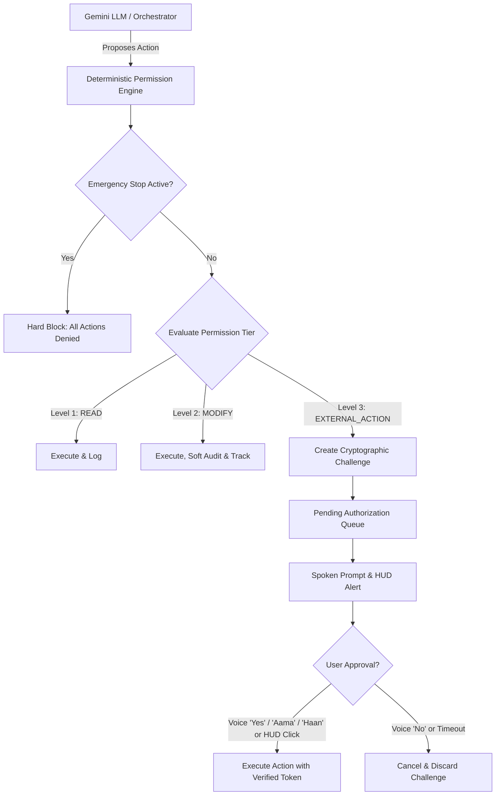

# JARVIS Mark VII: Safety & Permission Architecture

## 1. Principles & Threat Model

JARVIS operates as an autonomous computer-use agent with access to native Windows APIs, accessibility controls, web browsers, and communication platforms. Because an LLM can hallucinate or misinterpret user intent, safety cannot rely on the model itself.

Instead, JARVIS implements a **Dual-Gate Security Model**:
1. **Model Gate:** The Gemini orchestrator reasons about the task and generates tool calls.
2. **Deterministic Local Kernel Gate:** The `PermissionEngine` ([core/security/permissions.py](file:///c:/Users/karth/OneDrive/Desktop/sanju/core/security/permissions.py)) validates the target action, assesses its security tier, verifies emergency stop status, and enforces confirmation challenges before any low-level driver or API executes.

---

## 2. Three-Tier Permission Hierarchy

Every capability in the system belongs to one of three strictly enforced tiers:

### Tier 1: `LEVEL_1_READ`
- **Impact:** Non-destructive, zero state change on host or external networks.
- **Examples:**
  - Screen captures & OCR extraction (`computer.capture_screen`)
  - Active window detection (`computer.get_active_window`)
  - Inspecting UI accessibility tree (`computer.inspect_ui`)
  - Webpage DOM reading (`browser.inspect_page`)
  - Contact queries (`whatsapp.find_contact`)
  - File reading and vector semantic searching (`files.search`)
- **Handling:** Auto-approved; logged in audit stream.

### Tier 2: `LEVEL_2_MODIFY`
- **Impact:** Local state changes that are reversible or confined to the current session.
- **Examples:**
  - Launching desktop applications (`computer.open_application`)
  - Typing in an active text box or switching windows (`computer.type_text`)
  - Scrolling a document or webpage (`computer.scroll`)
  - Filling form fields or worksheet drafts (`worksheet.fill_answers`)
  - Staging code edits or organizing temporary downloads
- **Handling:** Executed with verified post-action diffing; logged in audit stream.

### Tier 3: `LEVEL_3_EXTERNAL_ACTION`
- **Impact:** Irreversible, outward-facing actions affecting real-world communications, financial transactions, or permanent data loss.
- **Examples:**
  - Sending WhatsApp messages (`whatsapp.send_message`)
  - Submitting online forms/worksheets (`worksheet.submit`)
  - Deleting critical files or terminating processes
  - Making purchases or changing account credentials
- **Handling:** **STRICT INTERCEPTION**. The action is frozen. JARVIS prompts the user verbally and through the HUD. The action CANNOT execute without explicit user confirmation.

---

## 3. Out-of-Band Challenge & Confirmation Lifecycle

When a Level 3 action is proposed:
1. `PermissionEngine.request_permission()` generates a unique `challenge_id` and records the pending payload (e.g. `recipient: "Father"`, `message: "Hi"`).
2. The orchestrator halts execution and prepares a plain-language confirmation prompt:
   - Spoken: *"I found your father's conversation. Should I send 'Hi'?"*
   - HUD: Alert card displaying action type, target recipient, message preview, and [Confirm] / [Cancel] buttons.
3. The user confirms via:
   - Spoken confirmation: *"Yes"*, *"Send it"*, *"Aama"*, *"Haan"*.
   - HUD action: Click [Confirm].
4. `ContinuousConversationManager.resolve_voice_confirmation()` validates the affirmative response and issues a temporary authorization token.
5. The action is executed and delivery is verified.

---

## 4. Global Emergency Stop Architecture

JARVIS includes a hardware-style emergency stop that immediately halts all computer interaction:

- **Voice Trigger:** Speaking *"Jarvis, emergency stop"* or *"Stop everything"*.
- **HUD Trigger:** Clicking the red **EMERGENCY ABORT** button on the Core HUD.
- **API Endpoint:** `POST /api/v1/automation/emergency-stop`.
- **Fail-Safe Behavior:**
  - Sets thread-safe flag `_emergency_stop_active = True`.
  - Aborts any ongoing `AutonomousObservationLoop` steps.
  - Releases mouse and keyboard hooks immediately.
  - Silences all ongoing TTS audio playback.
  - Blocks all subsequent tool calls across all tiers until an explicit reset (`POST /api/v1/automation/emergency-reset` or spoken *"Jarvis, resume operations"*).

---

## 5. Anti-Abuse & Sandbox Constraints

To maintain compliance and protect user accounts:
- **No CAPTCHA / Bot Gate Bypass:** JARVIS strictly refuses to click through or bypass CAPTCHAs, bot gates, or Cloudflare challenges; it notifies the user to complete verification manually in the browser.
- **Anti-Hallucination Contact Guard:** When a contact query is ambiguous (e.g. multiple contacts named "John"), JARVIS lists candidates and asks for clarification before preparing any message.
- **Audit Logging:** Every authorization request, grant, rejection, and emergency stop is appended to `storage/logs/audit.log` with UTC timestamp and process metadata.
