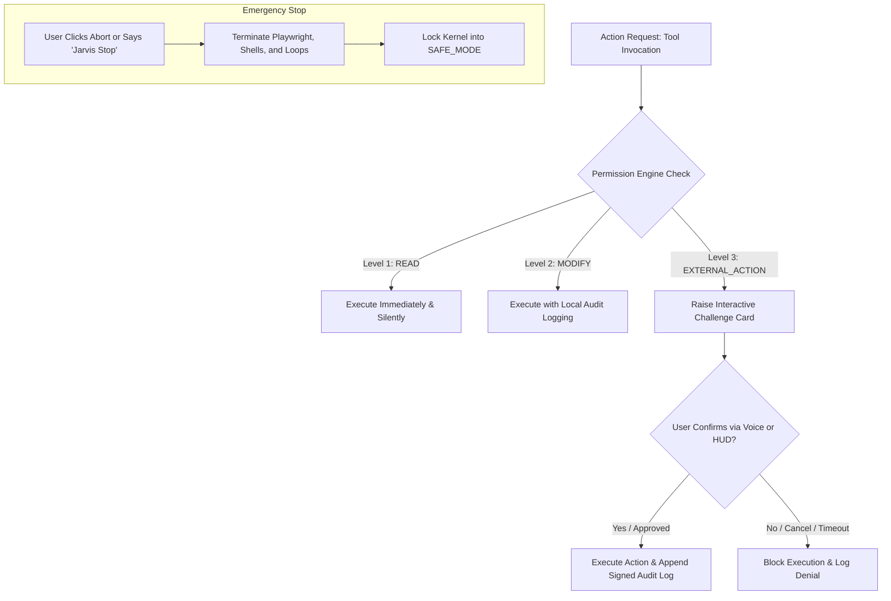

# JARVIS-10: Permission Architecture & Security Model

## 1. Safety Philosophy

Universal autonomous computer use requires strict operational boundaries. JARVIS-10 is governed by a non-bypassable, locally enforced permission interceptor (`core/security/permissions.py`) that separates safe operations from consequential external actions.

---

## 2. Three-Tier Permission Hierarchy

### Level 1: `READ` (Safe / Unrestricted)
- **Scope**: Reading active web pages, inspecting desktop windows, extracting metadata, searching files, capturing screenshots, checking hardware telemetry.
- **Enforcement**: Allowed automatically without user interruption.

### Level 2: `MODIFY` (Local Modification / Controlled)
- **Scope**: Typing text, editing documents, creating spreadsheets/presentations, moving files with preview, filling form fields.
- **Enforcement**: Executed and logged to local audit database. Bulk file movements default to preview mode.

### Level 3: `EXTERNAL_ACTION` (Consequential / Mandatory Confirmation)
- **Scope**: Sending WhatsApp messages, submitting online worksheets/forms, deleting files, executing arbitrary shell scripts, making financial purchases.
- **Enforcement**: Strictly blocked until the user provides explicit verbal (*"Yes"*, *"Send it"*, *"Aama"*, *"Haan"*) or visual confirmation on the HUD.
- **Anti-Bypass Guard**: The LLM / Gemini cannot bypass local permission enforcement.

---

## 3. Strict Prohibitions & Anti-Abuse Policies

In accordance with strict safety directives:
1. **Never Bypass CAPTCHA or Bot Challenges**: JARVIS explicitly refrains from attempting to solve, wait out, or bypass CAPTCHAs, Cloudflare Turnstile, or anti-bot verification gates. If encountered, it pauses and notifies the user to complete it directly in the visible browser pane.
2. **Never Bypass MFA or Authentication Credentials**: JARVIS does not attempt to brute-force or intercept 2FA codes, session cookies, or hardware security keys.
3. **Never Defeat Paywalls or Access Controls**: Only sanctioned, public, or user-authenticated paths are navigated.

---

## 4. Tamper-Evident Audit Logging

Every intercepted request, user decision, and tool execution is stored in an append-only cryptographic ledger (`storage/db/jarvis.db` and JSONL audit trail):
- Records: `timestamp`, `tool_name`, `permission_level`, `target_resource`, `parameters`, `decision`, `hash_checksum`.
- Uses SHA-256 block chaining to ensure logs cannot be retroactively altered.
