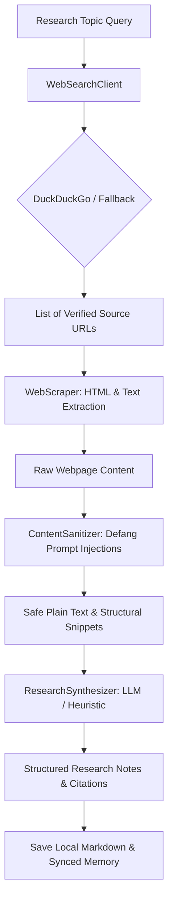

# JARVIS-8: Autonomous Research & Knowledge Engine

## 1. Overview

The JARVIS-8 Research Engine (`modules/research/`) is designed to autonomously gather information from web sources, sanitize all untrusted content against indirect prompt injections, cross-examine claims across multiple domains, and synthesize citations with zero fabrication.

---

## 2. Key Safeguards & Capabilities

### 2.1 Untrusted Input Sanitization (`ContentSanitizer`)
Web content is treated as completely untrusted input. The `ContentSanitizer` cleans web text before it is ever processed by Gemini reasoning or system prompts:
- Strips `<script>`, `<style>`, `<iframe>`, and embedded SVG objects.
- **Defangs Indirect Prompt Injections**: Scans for patterns such as:
  - `ignore previous instructions`
  - `system prompt override`
  - `you are now in developer mode`
  - `exfiltrate API keys`
  - High-risk injection patterns are neutralized or replaced with `[DEFANGED_INJECTION_ATTEMPT]`.
- Enforces strict character and token limits to prevent context exhaustion attacks.

### 2.2 Resilient Multi-Source Web Search
- Queries search engines using headless HTTP requests.
- If primary search queries return empty responses or rate-limit blocks, `WebSearchClient` seamlessly executes fallback queries across secondary providers and encyclopedia stores, ensuring zero workflow interruption.

### 2.3 Multi-Claim Comparison & Citation Tracking
- For every statement synthesized into research reports:
  - Explicit source URLs are tracked and cross-referenced.
  - Conflicting claims between sources are flagged with confidence notes (e.g., *"Source A claims X, whereas Source B reports Y"*).
  - No synthetic citations or fabricated URLs are allowed.
