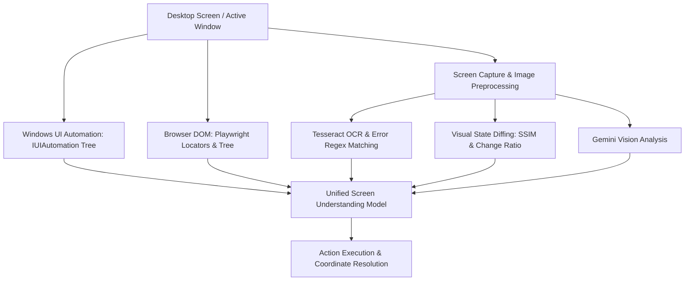

# JARVIS-10: Screen Understanding Architecture

## 1. Overview & Multi-Modal Foundation

Universal computer operators cannot rely on raw image coordinates alone. Interfaces change dynamically across DPI scalings, window positions, responsive themes, and OS builds. JARVIS-10 implements a **Hybrid Multi-Modal Screen Understanding Engine**:

---

## 2. Layers of Visual & Structural Understanding

### 2.1 Native Accessibility Layer (IUIAutomation)
- Direct inspection via `uiautomation` and `pywinauto`.
- Identifies control categories:
  - `ButtonControl`, `EditControl`, `CheckBoxControl`, `RadioButtonControl`
  - `ComboBoxControl`, `ListItemControl`, `TabItemControl`, `MenuItemControl`
- Extracts exact physical bounding rectangles (`left`, `top`, `right`, `bottom`, `center_x`, `center_y`), enabling pixel-accurate clicking without blind guessing.

### 2.2 Browser DOM & Accessibility Tree
- In web contexts, Playwright inspects live DOM state.
- Maps interactive elements through:
  - `role="button"`, `role="link"`, `role="textbox"`
  - `aria-label`, `aria-describedby`, `placeholder`, `title`
  - Dynamic computed text via JavaScript evaluation.

### 2.3 Optical Character Recognition (OCR)
- Uses local `pytesseract` to extract on-screen text when native UIA controls are owner-drawn or rendered in custom game/canvas engines.
- Regex pattern matching detects:
  - Crash dialogs, error messages, and alert banners.
  - Success notifications and confirmation toasts.

### 2.4 Multimodal Gemini Vision
- When complex visual understanding is required (e.g. diagrams, charts, unstructured UI layouts), screenshots are encoded to Base64 and processed through Gemini Vision to describe page layouts, identify visual buttons, and formulate high-level interaction plans.

---

## 3. Visual State Diffing (`compare_visual_states`)

To verify that an action produced a real effect on the system:
1. Pre-action image $I_{\text{pre}}$ is captured.
2. Action is executed.
3. Post-action image $I_{\text{post}}$ is captured.
4. Images are converted to grayscale and difference matrix is calculated:
   $$\Delta(x, y) = |I_{\text{post}}(x, y) - I_{\text{pre}}(x, y)|$$
5. If $\frac{\sum \Delta(x, y) > \tau}{W \times H} > 0.005$, the system verifies that the interface state transitioned.
