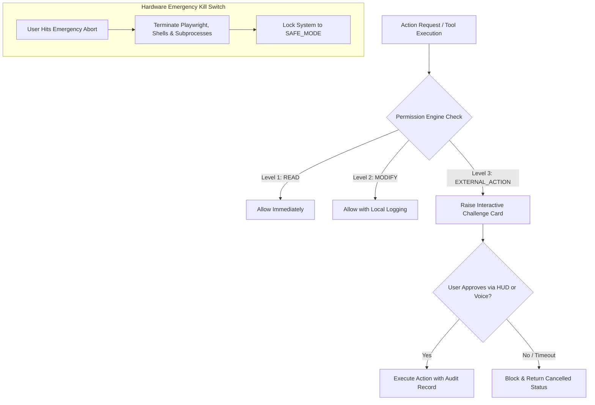

# JARVIS-8: Security Audit & Safety Architecture

## 1. Safety & Permission Philosophy

Autonomous computer use and multi-application intelligence introduce potential risk if operations are executed without boundaries. JARVIS-8 implements a defense-in-depth security model governed by:
1. **Three-Tier Permission Hierarchy**
2. **Level 3 Interactive Authorization Gate**
3. **Hardware-Level Emergency Stop (Kill Switch)**
4. **Append-Only Audit Logging**



---

## 2. Permission Tiers

| Tier | Name | Scope of Operations | Approval Required |
|---|---|---|---|
| **Level 1** | `READ` | Reading local files, getting telemetry, listing running applications, searching web, capturing screen | None (Safe) |
| **Level 2** | `MODIFY` | Creating office documents, writing notes, organizing folders (dry-run previews) | Logged automatically |
| **Level 3** | `EXTERNAL_ACTION` | Sending WhatsApp messages, submitting web forms, bulk deleting files, executing arbitrary shell code | **Mandatory Explicit Confirmation** |

---

## 3. Level 3 Interactive Authorization Guardrail

When an operation classified as Level 3 (e.g. `whatsapp.send_message` or `worksheet.submit`) is triggered:
1. The execution engine halts before dispatching the payload.
2. A unique `challenge_id` is generated with action details, recipient/target, and payload summary.
3. The frontend `TaskManagerHUD` renders an interactive Challenge Card with explicit **Approve** and **Deny** controls.
4. The user may also approve via natural voice (*"Yes, send it"* or *"No, cancel"*).
5. If denied or timed out (60s default), the operation is aborted and cannot execute.

---

## 4. Emergency Stop Protocol (`core/safety/emergency_stop.py`)

- **Instantaneous Hard Stop**: Triggered by either the red HUD Emergency Abort button or voice command *"Jarvis, stop immediately"*.
- **Consequences of Abort**:
  - Closes all active Playwright browser contexts.
  - Terminates spawned child processes and shell sandboxes.
  - Cancels all running DAG execution waves.
  - Transitions the kernel into `SAFE_MODE` until explicitly reset.

---

## 5. Security Audit Log
Every action, tool call, permission evaluation, and user decision is permanently stored in an append-only JSONL log (`data/audit/audit.log`):
```json
{
  "timestamp": "2026-11-15T21:40:00Z",
  "actor": "user",
  "tool": "whatsapp.send_message",
  "tier": 3,
  "decision": "APPROVED",
  "challenge_id": "ch_7a89b0",
  "hash": "e3b0c44298fc1c149afbf4c8996fb92427ae41e4649b934ca495991b7852b855"
}
```
