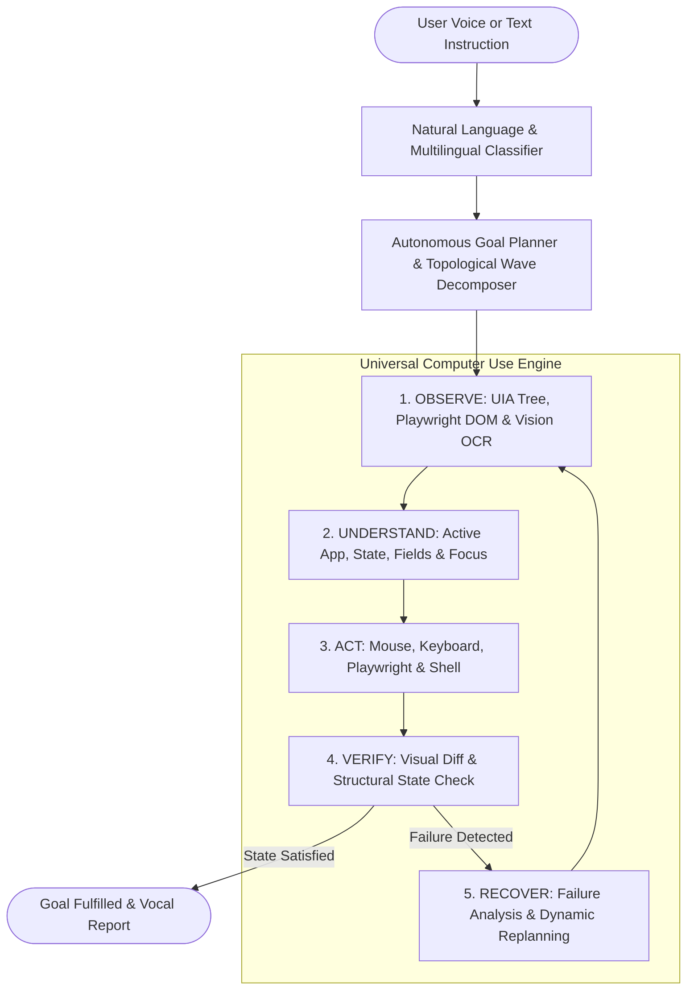

# JARVIS-10: Universal Computer Use & Autonomous Interaction Architecture

## 1. Executive Summary & Objective

JARVIS-10 upgrades the JARVIS AI Operating System from a task assistant into a **Universal Autonomous Computer Operator**. Instead of requiring step-by-step mouse coordinates or keyboard instructions, JARVIS receives high-level natural language objectives, observes the active environment across Windows applications and browsers, plans the sequence of operations, executes them with safety guardrails, and independently verifies the physical outcome.

---

## 2. Universal Interaction Capabilities

JARVIS-10 operates across three fundamental execution layers:

### 2.1 Native Windows Applications (`native_uia` & `mouse_kb`)
- **Accessibility Tree Traversal**: Uses Windows UI Automation (UIA) to discover controls, buttons, text fields, checkboxes, tabs, and menus without relying on brittle screen coordinates.
- **Physical Input Simulation**: PyAutoGUI integration with automatic coordinate clamping, humanized easing movement (`easeOutQuad`), configurable character pacing, single/double/right clicks, and drag-and-drop.
- **Application Lifecycle**: Indexing and discovery across 340+ Win32, UWP, Microsoft Store apps, and Windows System utilities.

### 2.2 Universal Web & Browser Interaction (`PlaywrightBrowserController`)
- **Direct Engine Integration**: Complete Playwright control across Chrome, Edge, and Chromium.
- **Multi-Tab Architecture**: Real-time tab enumeration, tab switching, background tab navigation, and clean tab teardown.
- **DOM & Visual Locators**: Text selectors, CSS selectors, ARIA roles, bounding box geometry, and evaluated DOM dispatch.

### 2.3 Visual Intelligence & Screen OCR (`screen_intelligence` & `analyzer`)
- **High-DPI Desktop Capture**: Full desktop and region-specific window capture.
- **Structural Diffing**: SSIM and pixel-ratio state comparison (`compare_visual_states`) to confirm that actions cause the expected interface transition.
- **OCR Error Signatures**: Optical character recognition to identify dialogs, error banners, and loading spinners.

---

## 3. Autonomous Feedback Loop (OBSERVE $\to$ UNDERSTAND $\to$ PLAN $\to$ ACT $\to$ VERIFY $\to$ REPEAT)

Every action in JARVIS-10 is subject to strict verification:
1. **Observe**: Captures pre-action visual state and active window hierarchy.
2. **Understand**: Evaluates form state, button enabledness, or text content.
3. **Plan**: Selects the highest-reliability interaction strategy (UIA $\to$ DOM $\to$ Visual Coordinate fallback).
4. **Act**: Dispatches the action with permission interception.
5. **Verify**: Captures post-action visual state, computes change ratio, checks window title and DOM element changes.
6. **Repeat**: If the target state is not reached, analyzes error signature, generates a corrective alternative, and retries within configured retry bounds (default: 3 attempts).

---

## 4. Universal Tool Registry

The universal computer-use toolset provides granular, reusable capabilities:

| Tool Namespace | Tool Name | Description | Permission Tier |
|---|---|---|---|
| `computer.*` | `computer.capture_screen` | Captures primary display screenshot | Level 1 (Read) |
| `computer.*` | `computer.inspect_active_window` | Identifies active window, title, process, bounds | Level 1 (Read) |
| `computer.*` | `computer.inspect_ui` | Traverses accessibility tree for interactive elements | Level 1 (Read) |
| `computer.*` | `computer.find_element` | Locates control by name, label, or type | Level 1 (Read) |
| `computer.*` | `computer.click` | Clicks by coordinates or accessible label | Level 2 (Modify) |
| `computer.*` | `computer.type` | Types text safely into focused element | Level 2 (Modify) |
| `computer.*` | `computer.press_key` | Presses individual key or shortcut | Level 2 (Modify) |
| `computer.*` | `computer.scroll` | Scrolls vertically (up or down) | Level 2 (Modify) |
| `computer.*` | `computer.switch_window` | Brings matching window to foreground | Level 2 (Modify) |
| `computer.*` | `computer.verify_action` | Compares pre/post screenshots for UI changes | Level 1 (Read) |
| `browser.*` | `browser.open` | Navigates Playwright browser to target URL | Level 1 (Read) |
| `browser.*` | `browser.inspect` | Inspects DOM structure, forms, buttons, links | Level 1 (Read) |
| `browser.*` | `browser.search` | Executes search on Google, YouTube, or DuckDuckGo | Level 1 (Read) |
| `browser.*` | `browser.click` | Clicks element by CSS, text, or ARIA label | Level 2 (Modify) |
| `browser.*` | `browser.fill` | Populates input or textarea field | Level 2 (Modify) |
| `browser.*` | `browser.extract_text` | Extracts clean readable text or markdown | Level 1 (Read) |
| `browser.*` | `browser.get_tabs` | Lists all open tabs with titles and URLs | Level 1 (Read) |
| `browser.*` | `browser.screenshot` | Captures high-resolution webpage screenshot | Level 1 (Read) |
| `page.*` | `page.analyze` | Deep structural and readability breakdown | Level 1 (Read) |
| `page.*` | `page.find_element` | Locates elements matching label, id, or query | Level 1 (Read) |
| `page.*` | `page.extract_questions` | Extracts worksheet and form questions | Level 1 (Read) |
| `page.*` | `page.extract_tables` | Parses HTML tables into structured JSON | Level 1 (Read) |
| `page.*` | `page.fill_form` | Populates form dictionary into input fields | Level 2 (Modify) |
| `page.*` | `page.verify_form` | Verifies completion and highlights missing fields | Level 1 (Read) |
| `youtube.*` | `youtube.search` | Searches YouTube and extracts video cards | Level 1 (Read) |
| `youtube.*` | `youtube.play_video` | Plays video by result index (1st, 2nd, 3rd) | Level 2 (Modify) |
| `youtube.*` | `youtube.control_playback` | Play, pause, mute, volume adjustments | Level 2 (Modify) |
