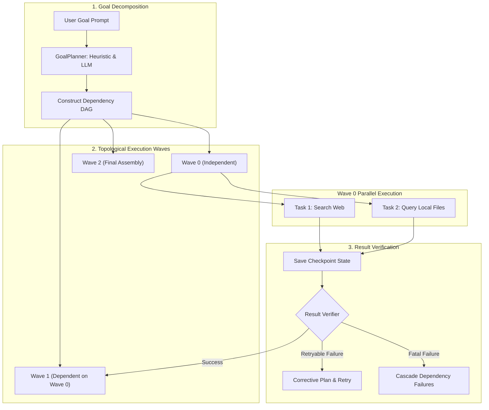

# JARVIS-8: Workflow & Planning Engine Specification

## 1. Overview

The JARVIS-8 Workflow Engine coordinates multi-step autonomous tasks via Directed Acyclic Graphs (DAG). It guarantees that tasks execute in mathematically sound topological order, executes independent actions in parallel waves, cascades failures predictably, and supports resumption from persisted checkpoints.

---

## 2. DAG Topology & Dependency Resolution

### 2.1 Cycle Detection & Validation
Before executing any plan, `DAGPlanner` executes a Depth-First Search (DFS) cycle check:
- If a cycle is detected ($A \to B \to A$), the engine rejects the graph immediately with `ValueError: Cycle detected in task dependencies`.
- Tasks with no incoming dependencies are classified into **Wave 0**.
- Subsequent tasks are scheduled into waves according to the maximum depth of their dependent ancestors:
  $$\text{Wave}(T) = 1 + \max_{D \in \text{deps}(T)} \text{Wave}(D)$$

### 2.2 Parallel Dispatch via Topological Waves
Tasks residing within the same wave are completely independent and are dispatched concurrently using `asyncio.gather`:
- Example: Searching the web for "warehouse robotics" and indexing local files for "logistics papers" run in parallel.
- Execution completes when all tasks in the wave succeed or report status.

---

## 3. Failure Cascading & Error Containment

If a task in an upstream wave fails fatally:
1. **Immediate Failure Propagation**: All downstream tasks that declare this task as a dependency are transitioned directly to status `CANCELLED` / `FAILED_DEPENDENCY`.
2. **Independent Branch Preservation**: Any sibling branches that do not depend on the failed task continue execution uninterrupted.
3. **Checkpoint Persistence**: The state of all completed tasks is saved to disk (`data/checkpoints/`), ensuring that re-running the workflow does not repeat completed work.

---

## 4. Verification & Dynamic Re-planning

### 4.1 Post-Execution Verification
Every step executed by the DAG Engine passes through `ResultVerifier`:
- Evaluates exit codes, file existence, and output payload schemas.
- If an output does not satisfy the criteria (e.g., file size is 0 bytes), the step is marked `RETRYABLE`.
- Maximum retry count defaults to 2 attempts with exponential backoff and corrective parameter adjustments.

### 4.2 Interactive HUD Integration
The DAG execution state is broadcast in real time to the frontend `TaskManagerHUD.tsx` over WebSockets:
- Node statuses: `PENDING`, `IN_PROGRESS`, `COMPLETED`, `FAILED`, `CANCELLED`.
- Interactive controls: **Pause**, **Resume**, and **Cancel** buttons allow the user to pause execution waves or trigger emergency stops at any time.
